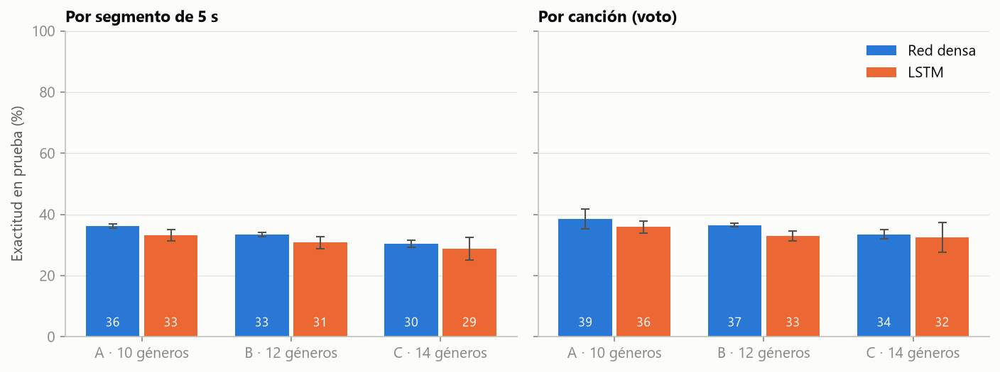
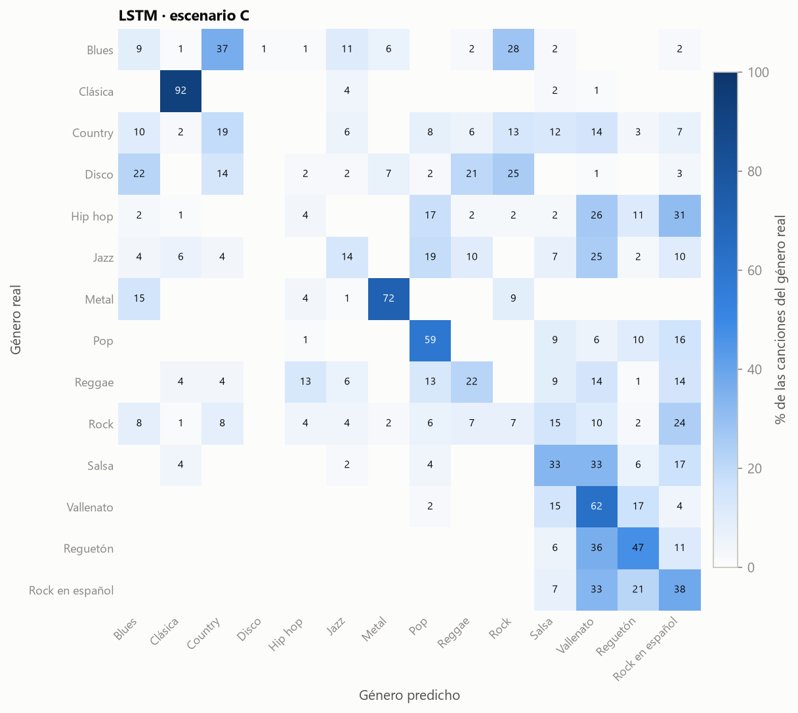
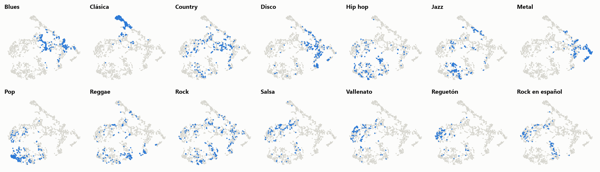
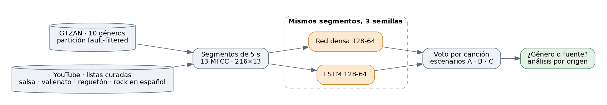

# Géneros musicales con MFCC: red densa frente a LSTM

Clasificación de géneros musicales a partir de coeficientes MFCC sobre segmentos de 5 segundos,
comparando una red densa con una LSTM. Se usan los 10 géneros de GTZAN y luego se amplía con salsa,
vallenato, reguetón y rock en español a partir de listas curadas de YouTube.

## Pregunta

Con la misma entrada (13 MFCC por ventana sobre segmentos de 5 s), ¿clasifica mejor el género una
red recurrente (LSTM) que una red densa? ¿Y qué aprende el modelo cuando se agregan géneros que
vienen de otra fuente de grabación?

## Respuesta corta

- **La LSTM no supera a la red densa.** En los tres escenarios la densa queda igual o por encima,
  con diferencias del orden de la variación entre semillas. Con 10 géneros, la densa acierta el
  38,5 % de las canciones de prueba y la LSTM el 35,9 % (azar: 10 %).
- **Ambos modelos generalizan poco.** Ningún artista se repite entre entrenamiento y prueba, y con
  esa partición los dos se ajustan al entrenamiento (62–74 %) pero en validación se estancan cerca
  del 35 %.
- **Los MFCC capturan la fuente tanto como el género.** Las canciones de reguetón y rock en español
  que el modelo nunca vio se asignan a salsa y vallenato, los otros géneros de YouTube. El rock en
  español nunca se predice como rock.



*Exactitud en prueba, media ± desviación entre 3 semillas. Escenario A: 10 géneros de GTZAN; B: + salsa
y vallenato; C: + reguetón y rock en español.*

## Resultados

Exactitud en prueba (media ± desviación entre 3 semillas). La exactitud por canción usa el voto de
sus segmentos.

<!-- resultados:principal -->
| Escenario | Géneros | Modelo | Parámetros | Exactitud por segmento (%) | Exactitud por canción (%) |
| --- | ---: | --- | ---: | ---: | ---: |
| A | 10 | Red densa | 368.458 | 36,2 ± 0,8 | 38,5 ± 3,2 |
| A | 10 | LSTM | 126.922 | 33,2 ± 1,8 | 35,9 ± 2,1 |
| B | 12 | Red densa | 368.588 | 33,5 ± 0,8 | 36,5 ± 0,6 |
| B | 12 | LSTM | 127.052 | 30,8 ± 2,0 | 33,0 ± 1,6 |
| C | 14 | Red densa | 368.718 | 30,4 ± 1,2 | 33,5 ± 1,4 |
| C | 14 | LSTM | 127.182 | 28,8 ± 3,7 | 32,5 ± 4,8 |
<!-- /resultados:principal -->

Los conjuntos de prueba crecen de un escenario a otro, así que la comparación entre escenarios es
indicativa; la comparación entre modelos dentro de un escenario usa exactamente los mismos segmentos.

### Por género (escenario C, exactitud por canción, %)

<!-- resultados:por_genero -->
| Género | Red densa | LSTM |
| --- | ---: | ---: |
| Blues | 4 | 9 |
| Clásica | 96 | 92 |
| Country | 17 | 19 |
| Disco | 1 | 0 |
| Hip hop | 2 | 4 |
| Jazz | 9 | 14 |
| Metal | 96 | 72 |
| Pop | 59 | 59 |
| Reggae | 28 | 22 |
| Rock | 7 | 7 |
| Salsa | 31 | 33 |
| Vallenato | 58 | 62 |
| Reguetón | 31 | 47 |
| Rock en español | 43 | 38 |
<!-- /resultados:por_genero -->

Los aciertos se concentran en géneros de timbre muy marcado (clásica, metal, pop). Disco y rock casi
nunca se reconocen.



### ¿Género o fuente?

Por fuente real de la canción: qué parte se predice como un género de la misma fuente (GTZAN o
YouTube) y qué parte acierta el género.

<!-- resultados:fuente -->
| Escenario | Modelo | Canciones de | Predichas como un género de la misma fuente (%) | Género correcto (%) |
| --- | --- | --- | ---: | ---: |
| B | Red densa | GTZAN | 83,3 | 34,1 |
| B | Red densa | YouTube | 79,2 | 58,3 |
| B | LSTM | GTZAN | 86,6 | 30,9 |
| B | LSTM | YouTube | 84,4 | 52,1 |
| C | Red densa | GTZAN | 71,7 | 32,0 |
| C | Red densa | YouTube | 85,6 | 41,4 |
| C | LSTM | GTZAN | 71,0 | 29,9 |
| C | LSTM | YouTube | 96,6 | 45,4 |
<!-- /resultados:fuente -->

Un modelo entrenado con salsa y vallenato (escenario B) frente a géneros de YouTube que nunca vio:

<!-- resultados:fuera -->
| Género no visto | Modelo | Géneros asignados con más frecuencia (% de las canciones) |
| --- | --- | --- |
| Rock en español | Red densa | Vallenato 33, Pop 16, Hip hop 11 |
| Rock en español | LSTM | Vallenato 29, Salsa 23, Hip hop 18 |
| Reguetón | Red densa | Vallenato 53, Pop 16, Salsa 15 |
| Reguetón | LSTM | Vallenato 48, Salsa 21, Pop 17 |
<!-- /resultados:fuera -->

### El experimento del rock en español (escenario C)

Rock ya es un género de GTZAN. La pregunta era si el modelo distingue el rock en español del rock de
GTZAN y por qué.

<!-- resultados:rock -->
| Modelo | Canciones de | Predichas como rock en español (%) | Predichas como rock (%) | Otro género (%) |
| --- | --- | ---: | ---: | ---: |
| Red densa | Rock en español | 42,9 | 0,0 | 57,1 |
| Red densa | Rock | 31,2 | 7,3 | 61,5 |
| LSTM | Rock en español | 38,1 | 0,0 | 61,9 |
| LSTM | Rock | 24,0 | 7,3 | 68,8 |
<!-- /resultados:rock -->

El rock en español nunca se predice como rock. En cambio, una parte del rock de GTZAN se predice como
rock en español. Los MFCC describen el timbre, no la letra, así que el modelo no tiene cómo usar el
idioma: el rock en español se comporta como un género más de la fuente YouTube.

En el mapa t-SNE de la representación aprendida por la LSTM, solo la clásica forma una región
compacta. Los segmentos de YouTube, en cambio, tienden a agruparse entre sí.



### Demo interactiva

No se construye. Estaba condicionada a que el modelo generalizara a audio de otra fuente, y los
resultados muestran lo contrario: un audio externo se clasificaría sobre todo por cómo fue grabado.

## Método



**Datos**

- **GTZAN**, descargado de Kaggle con verificación SHA-256. Se usa la partición *fault-filtered* de
  Kereliuk, Sturm y Larsen (2015), que descarta repeticiones y grabaciones dañadas y no comparte
  artistas entre entrenamiento, validación y prueba. Quedan 929 canciones (442 / 197 / 290); se
  excluye `jazz.00054`, que no se puede leer.
- **Salsa, vallenato, reguetón y rock en español**, desde listas curadas en `data_sources/` (video,
  segundo de inicio, artista, título y revisión del género a partir de artista, título y canal). Se usan máximo 3 canciones por artista
  y se descartan grabaciones en vivo, popurrís, versiones y colaboraciones donde el artista listado
  no es el principal. Cada canción se recorta a 30 s desde el segundo 30 y se convierte al formato
  de GTZAN (WAV mono, 22.050 Hz). Hay 100 canciones por género (89 en reguetón), repartidas **por
  artista** en 70/15/15. Los grupos y sus solistas o integrantes cuentan como un solo artista.
- El audio no se versiona ni se redistribuye; cada usuario lo descarga localmente.

**Representación y modelos**

- **Entrada:** 13 MFCC por ventana (n_fft 2048, salto 512) sobre segmentos de 5 s, es decir, 216 × 13
  por segmento. Se normaliza con la media y la desviación del entrenamiento.
- **Red densa:** 128-64 sobre el segmento aplanado, con L2 y dropout.
- **LSTM:** 128-64 que recorre el segmento en el tiempo, seguida de una capa densa de 64.
- **Datos de entrenamiento:** los dos modelos se entrenan con los mismos segmentos.

**Protocolo**

- La parada temprana se decide con la pérdida en validación (paciencia 15).
- El dropout (0,3 o 0,5) y la tasa de aprendizaje (1e-3 o 3e-4) se eligieron en validación con el
  escenario A. La prueba se evalúa solo en las corridas finales.
- Cada configuración final se entrena con 3 semillas y se reportan la media y la desviación.
- **Métricas:** exactitud por segmento, exactitud por canción (mayoría de votos de sus segmentos,
  con desempate por probabilidad media) y matrices de confusión por canción. El mapeo índice → género
  sale del propio pipeline y está cubierto por pruebas.

<details>
<summary>Búsqueda de hiperparámetros (validación, escenario A, semilla 0)</summary>

<!-- resultados:busqueda -->
| Modelo | Dropout | Tasa de aprendizaje | Mejor época | Validación por segmento (%) | Validación por canción (%) |
| --- | ---: | ---: | ---: | ---: | ---: |
| LSTM | 0,3 | 0,0003 | 2 | 31,8 | 32,5 |
| LSTM | 0,3 | 0,001 | 1 | 30,7 | 29,4 |
| LSTM | 0,5 | 0,0003 | 2 | 31,0 | 31,0 |
| LSTM | 0,5 | 0,001 | 2 | 35,8 | 37,1 |
| Red densa | 0,3 | 0,0003 | 2 | 32,4 | 33,5 |
| Red densa | 0,3 | 0,001 | 1 | 35,1 | 38,1 |
| Red densa | 0,5 | 0,0003 | 4 | 36,4 | 39,6 |
| Red densa | 0,5 | 0,001 | 3 | 34,9 | 34,5 |
<!-- /resultados:busqueda -->

</details>

## Limitaciones

- **Datos:** el conjunto es pequeño (442 canciones de entrenamiento en GTZAN y entre 62 y 72 por
  género nuevo). La prueba de cada género nuevo tiene entre 12 y 16 canciones.
- **Representación:** 13 MFCC por ventana describen el timbre, pero no el ritmo a largo plazo ni la
  armonía.
- **Etiquetas:** el género de las listas curadas se asignó por metadatos (artista, título y canal),
  sin escuchar cada canción ni una segunda revisión independiente. Una canción de un artista del
  género puede no pertenecer a él.
- **Diseño:** género y fuente no se pueden separar con estos datos. Para hacerlo harían falta los
  mismos géneros grabados desde varias fuentes.

## Estructura del repositorio

```
├── configs/          rejilla de hiperparámetros y corridas finales (TOML)
├── data_sources/     listas curadas, canciones usadas y su partición, SHA-256 de GTZAN
├── notebooks/
│   ├── 01_datos_y_exploracion.ipynb   datos, particiones, espectrogramas y MFCC
│   ├── 02_densa_vs_lstm.ipynb         escenario A
│   ├── 03_salsa_y_vallenato.ipynb     escenario B y la pregunta de la fuente
│   └── 04_extension.ipynb             escenario C, rock en español y mapa t-SNE
├── results/          un JSON por corrida, mapa t-SNE y figuras
├── scripts/          descarga, corridas, figuras y tablas del README
├── src/generos/      datos, particiones, MFCC, modelos, evaluación, figuras
└── tests/            particiones sin fugas, etiquetas, conteo de parámetros, README
```

## Cómo reproducir

Requiere Python 3.12 o superior (probado con 3.13 en Windows) y conexión a internet.

```bash
python -m venv .venv
.venv\Scripts\activate            # en Linux o macOS: source .venv/bin/activate
pip install -r requirements.txt

python -c "from generos import gtzan; gtzan.descargar()"   # GTZAN desde Kaggle (~1,2 GB)
python scripts/descargar_extension.py                      # géneros nuevos desde data_sources/
python scripts/run.py todo                                 # búsqueda y corridas finales (~2 h en CPU)
python scripts/figuras.py
python scripts/actualizar_readme.py
pytest                                                     # pytest -m notebooks ejecuta los cuadernos
```

`scripts/run.py` es reanudable: salta las corridas que ya tienen resultado. Si algún video de las
listas deja de estar disponible, la descarga lo informa en `logs/descargas.log`.

## Autor

Santiago Castellanos.

## Datos y licencias

- **GTZAN:** G. Tzanetakis y P. Cook, «Musical genre classification of audio signals», *IEEE
  Transactions on Speech and Audio Processing*, 10(5), 2002. Se distribuye solo con fines de
  investigación.
- **Partición fault-filtered:** C. Kereliuk, B. L. Sturm y J. Larsen, «Deep learning and music
  adversaries», *IEEE Transactions on Multimedia*, 17(11), 2015. Listas tomadas de
  [coreyker/dnn-mgr](https://github.com/coreyker/dnn-mgr).
- **Géneros nuevos:** el repositorio publica solo las referencias a los videos (identificador,
  segundo de inicio, artista y título). El audio pertenece a sus titulares y no se redistribuye.
- **Código:** licencia MIT (ver [LICENSE](LICENSE)).
